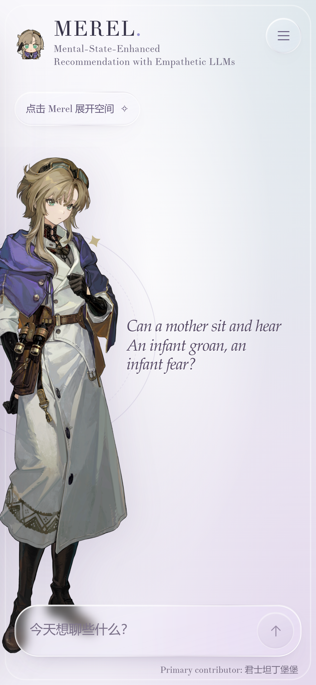

<p align="center">
  
</p>

<h1 align="center">
  <picture>
    <source media="(prefers-color-scheme: dark)" srcset="docs/images/merel-title-dark.svg">
    
  </picture>
</h1>

<p align="center">
  <a href="README.md">中文</a> · <strong>English</strong>
</p>

<p align="center">
  <a href="#quick-start">Quick start</a> · <a href="docs/demo.md">Demo guide</a> · <a href="docs/architecture.md">Architecture</a> · <a href="docs/api.md">API reference</a>
</p>

<p align="center">
  <a href="requirements.txt"></a>
  <a href="backend/app.py"></a>
  <a href="backend/gateway.py"></a>
</p>

MEREL is a dialogue prototype for research on personalized support for depressive experiences. It turns a user's description into evidence-linked state records, recommends a manageable action, and responds in Merel's voice. Users can correct their records, give feedback, complete small plans, and revisit the basis of each response.

**Expression → State → Support action → Empathetic response → Feedback & replay**

## What it does

| Capability | Implementation |
| --- | --- |
| **State tracking** | Track 12 indicators, duration and daily-life impact with source evidence. Unmentioned information stays unknown; users can revise it. |
| **Support actions** | Rank 30 support actions using the current state and recent repetition, with a visible selection rationale. |
| **Character voice** | DeepSeek combines character context, action-matched examples and recent dialogue, followed by a content review. Greetings follow a separate route. |
| **Plans & feedback** | Record helpfulness and effort, save an action as a small plan, and complete, archive or restore it. |
| **Decision replay** | Inspect the state snapshot, candidate actions, model calls and latency; export personal conversations, feedback and plans. |

<details>
<summary><strong>See the interface and expressions</strong></summary>

<p align="center">
  
</p>

Click Merel to open workspace navigation and browse 20 expressions in Settings. All 34 image assets first display a matching preview, then load a lossless full-resolution WebP. Late images cannot overwrite the expression currently selected.

</details>

## Quick start

Requires **Python 3.11+**. One service hosts the frontend and API; the model runs through an external API.

**Linux / macOS**

```bash
git clone https://github.com/ConstantineChenn/Merel.git
cd Merel
python3 -m venv .venv
.venv/bin/python -m pip install -r requirements.txt
cp .env.example .env
.venv/bin/python run.py
```

<details>
<summary>Windows PowerShell</summary>

```powershell
git clone https://github.com/ConstantineChenn/Merel.git
cd Merel
python -m venv .venv
.venv\Scripts\python.exe -m pip install -r requirements.txt
Copy-Item .env.example .env
.venv\Scripts\python.exe run.py --open-browser
```

</details>

Open **[127.0.0.1:8787](http://127.0.0.1:8787/)**. To enable online replies, set `DEEPSEEK_API_KEY` in `.env` and restart. An empty key runs the local demo. Model and endpoint settings are listed in [.env.example](.env.example); Settings and Research Replay show the actual runtime mode and execution details.

See the **[deployment guide](docs/deployment.md)** for server setup, configuration and data persistence. The detailed guides are currently in Chinese.

## Development & verification

[`backend/`](backend) contains FastAPI and SQLite logic; [`frontend/`](frontend) uses native JavaScript modules. Character-language resources live in [`backend/voice/`](backend/voice). Interactive API documentation is available at `/docs`.

```bash
.venv/bin/python -m unittest discover -s tests -p "test_*.py" -v
node tests/test_expressions.mjs
node tests/test_state_form.mjs
node --test tests/test_voice_status.mjs
```

Node.js is only needed for frontend regression checks. Local acceptance on 2026-11-28 passed **61 backend test methods** and **65 real HTTP checkpoints**, with additional verification of live DeepSeek replies, duplicate-request recovery and progressive images. See [test results](docs/testing.md) for methods and reproduction steps.

Recommendations currently use the `state-rule-demo-v1` rules. A trained low-rank interaction ranker is not loaded. This project supports dialogue research and does not provide diagnosis.

---

<p align="center">
  <a href="frontend/images/merel/asset-sources.json">Character asset sources</a> · <a href="docs/images/README.md">Header typography & sticker</a> · <a href="frontend/fonts/SILOpenFontLicense.txt">Font license</a>
</p>
