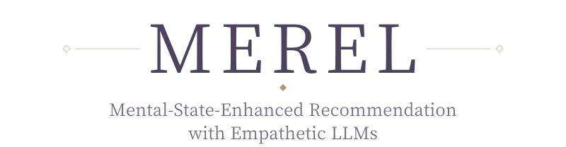
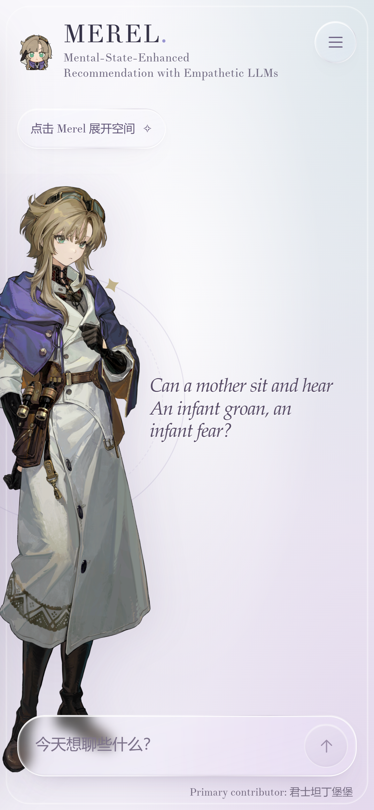

<p align="center">
  
</p>

<h1 align="center">
  <picture>
    <source media="(prefers-color-scheme: dark)" srcset="docs/images/merel-title-dark.svg">
    
  </picture>
</h1>

<p align="center">
  <strong>中文</strong> · <a href="README.en.md">English</a>
</p>

<p align="center">
  <a href="#快速启动">快速启动</a> · <a href="docs/demo.md">演示流程</a> · <a href="docs/architecture.md">系统架构</a> · <a href="docs/api.md">接口文档</a>
</p>

<p align="center">
  <a href="requirements.txt"></a>
  <a href="backend/app.py"></a>
  <a href="backend/gateway.py"></a>
</p>

MEREL 是面向个性化抑郁心理支持研究的对话原型。它将用户的描述转为有来源的状态记录，推荐一项可以尝试的小行动，再以 Merel 的语言风格回应。对话之后，用户可以修订状态、记录反馈、完成计划，并回看每轮回复的依据。

**表达 → 状态 → 支持动作 → 共情回应 → 反馈与回放**

## 能做什么

| 功能 | 具体实现 |
| --- | --- |
| **状态记录** | 记录 12 项表现、持续时间与生活影响，保留原文证据；未提及的信息保持未知，用户可以修订。 |
| **支持推荐** | 从 30 个支持动作中按状态和近期重复情况进行规则排序，展示选择依据。 |
| **角色对话** | DeepSeek 结合角色语境、同动作示例与近期对话生成并复核回复；日常问候单独处理。 |
| **行动反馈** | 记录帮助度和行动负担，将建议加入小计划，支持完成、归档与恢复。 |
| **过程回放** | 查看当轮状态、候选动作、模型调用与耗时，导出自己的对话、反馈和计划。 |

<details>
<summary><strong>查看界面与表情交互</strong></summary>

<p align="center">
  
</p>

点击 Merel 展开空间导航，在设置中预览 20 种神态。首次加载先显示低清预览，高清下载优先完成封面立绘，再预载当前点击会切换的表情。切换时保留已有高清图，下一张解码完成后再替换；已加载的图片在页面内复用，旧请求不会覆盖当前表情。

背景音乐为 **Mili — City Blue**，初始立绘加载结束后再请求轻量 AAC 版本并循环播放。浏览器限制自动播放时，在交互后开始；切换视图时音乐持续播放。

</details>

## 快速启动

需要 **Python 3.11+**。前后端由一个服务提供，模型通过外部 API 调用。

**Windows PowerShell**

```powershell
git clone https://github.com/ConstantineChenn/Merel.git
cd Merel
python -m venv .venv
.venv\Scripts\python.exe -m pip install -r requirements.txt
Copy-Item .env.example .env
.venv\Scripts\python.exe run.py --open-browser
```

<details>
<summary>Linux / macOS</summary>

```bash
git clone https://github.com/ConstantineChenn/Merel.git
cd Merel
python3 -m venv .venv
.venv/bin/python -m pip install -r requirements.txt
cp .env.example .env
.venv/bin/python run.py
```

</details>

打开 **[127.0.0.1:8787](http://127.0.0.1:8787/)**。启用在线模型时，在 `.env` 填写 `DEEPSEEK_API_KEY` 后重启；不填写则使用本地演示模式。模型名称与端点见 [.env.example](.env.example)，运行详情可在设置和研究回放中查看。

服务器部署、配置项与数据保留方式见 **[部署说明](docs/deployment.md)**。

## 开发与验证

核心代码位于 [`backend/`](backend) 和 [`frontend/`](frontend)，分别使用 FastAPI、SQLite 与原生 JavaScript。语言技能位于 [`backend/voice/`](backend/voice)，接口由 `/docs` 提供交互文档。

```powershell
.venv\Scripts\python.exe -m unittest discover -s tests -p "test_*.py" -v
node tests/test_expressions.mjs
node tests/test_state_form.mjs
node --test tests/test_voice_status.mjs
```

Node.js 仅用于前端回归测试。2026-11-28 本地验收通过 **61 个后端测试方法**、**65 个真实 HTTP 检查点**，并验证了 DeepSeek 实际回复、重复提交恢复和图片渐进加载。复现方法与结果见 [测试记录](docs/testing.md)。

当前推荐策略为 `state-rule-demo-v1` 规则演示；训练后的低秩交互排序器尚未加载。项目用于心理支持对话研究，不提供诊断。

---

<p align="center">
  <a href="frontend/images/merel/asset-sources.json">角色素材来源</a> · <a href="docs/images/README.md">页首字体与表情包</a> · <a href="frontend/fonts/SILOpenFontLicense.txt">字体许可</a>
</p>
