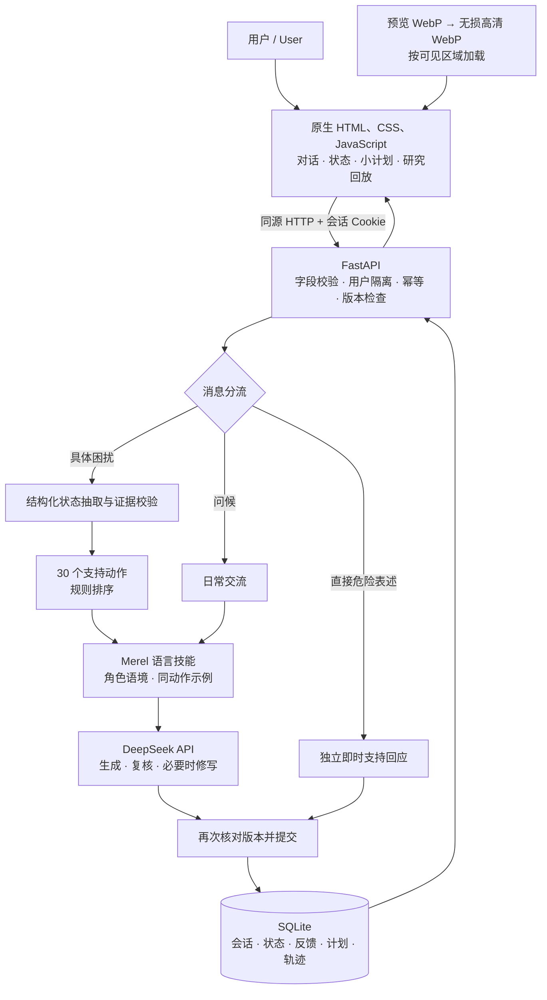
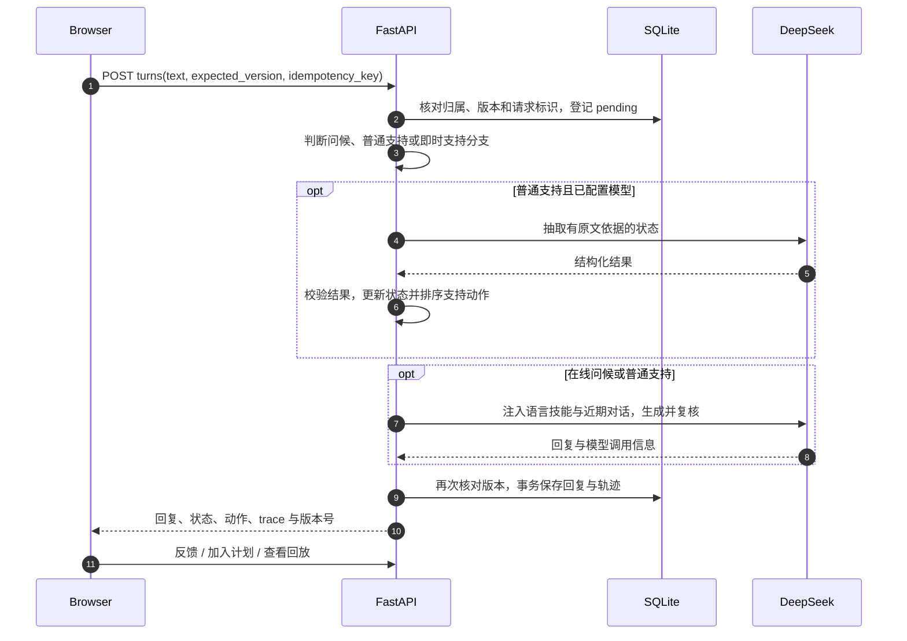

# MEREL · State-Aware Empathetic Dialogue

> **Mental-State-Enhanced Recommendation with Empathetic LLMs**<br>
> A research prototype connecting state tracking, support-action recommendation, empathetic dialogue and traceable feedback.<br>
> 将心理状态记录、支持动作推荐、共情对话与反馈回放连接起来的研究演示系统。

[快速启动](#quick-start--快速启动) · [部署说明](docs/deployment.md) · [接口说明](docs/api.md) · [测试记录](docs/testing.md) · [演示流程](docs/demo.md)

## Why MEREL? | 项目介绍

MEREL 面向个性化抑郁心理支持对话研究，围绕一个问题组织交互：**在了解用户当前处境后，如何给出合适、可执行、能够回看的支持？**

用户描述近期感受，系统记录相关状态，从动作目录中选择一项支持方式，再由 DeepSeek 生成回应。用户可以修订状态、评价本次支持、保存小计划，并在研究回放中查看这次回复使用了哪些信息。Merel 的表情和语言风格随对话场景变化，让记录、交流与行动出现在同一界面中。

| Capability | 当前实现 |
| --- | --- |
| **State tracking · 状态记录** | 维护 12 项表现、持续时间和学习/生活/社交影响，保留原文证据、来源与逐轮快照；未提及的信息保持未知。 |
| **Support recommendation · 支持推荐** | 从 30 个候选动作中按当前状态和近期重复情况进行规则排序，展示候选分值与选择依据。 |
| **Empathetic dialogue · 共情对话** | 服务端调用 DeepSeek；普通轮次执行结构化抽取、回应生成及内容复核，纯问候使用独立交流分支。 |
| **Character voice · 角色语言** | 加载 Merel 语言技能、角色资料、语境与同动作示例；记录技能版本、复核结果与调用用量。 |
| **Feedback loop · 反馈与计划** | 记录帮助度、行动负担和备注，将支持动作保存为小计划，并支持完成、归档与恢复。 |
| **Traceability · 过程回放** | 每轮保存状态、动作、回复、模型调用、耗时和回退标记；用户可导出自己的记录。 |
| **Progressive assets · 渐进图片** | 34 份素材都有低清预览和无损高清 WebP，覆盖立绘、头像、导航表情与表情册。 |

<details>
<summary>查看手机尺寸的演示界面</summary>


截图来自本地浏览器模拟，非真实手机拍摄。
</details>

## Architecture | 系统架构



前后端由一个 Python 服务同源提供。浏览器不持有模型密钥，图片和字体随项目部署；正常运行无需 Node.js、前端构建工具或本地 GPU。

### Request Lifecycle | 一轮对话如何完成



模型请求在数据库事务之外执行。相同请求标识和内容重复提交会重放原结果；生成期间状态发生变化时拒绝过期提交。在线调用失败会明确记录回退情况，回放中的 `generator` 与 `warnings` 表示该轮实际执行结果。

## Engineering Highlights | 工程实现

- **HTTP 入口可用**：请求标识使用 `crypto.getRandomValues()`，发送流程兼容普通 HTTP 地址；箭头与 Enter 均经过浏览器验证。
- **数据与状态一致性**：匿名会话隔离、严格字段校验、幂等请求、乐观版本检查和 SQLite 事务共同约束写入。
- **失败可恢复**：响应丢失后可用原标识重试；503 和无效响应保留发送内容；409 冲突同步最新版本后再发送。
- **图片先显示再清晰**：34 份素材对应两种资源，高清保留原始尺寸及 RGBA 像素；最多同时下载 2 张高清，快速切换时防止旧图片覆盖新图片。
- **可检查的运行记录**：逐轮保存抽取/生成来源、耗时、动作排序、模型复核和反馈，区分在线回复与本地回退。

## Validation Baseline | 测试基线

以下是 **2026-11-28 本地版本** 的验收结果，各行使用不同统计口径，不合并为一个“测试用例总数”。

| 检查范围 | 结果 |
| --- | --- |
| Python 自动化回归 | **61 个测试方法通过**，含边界值、权限、幂等、并发、状态及模型异常场景 |
| 真实 HTTP 接口 | **65 个检查点通过**，断言状态码、字段、版本和持久化结果 |
| 真实 DeepSeek | 最近两组验收共 **4 次在线回复**，`generator=llm`；普通对话的结构化抽取通过 |
| 浏览器发送故障 | **7 组场景通过**，含重复操作、丢失响应、503、409 和切页恢复 |
| 图片专项 | **6 组场景通过**，含 34 组资源、延迟竞争、失败重试和限速加载 |
| 发布包复查 | 解包后重新执行后端回归与 3 套前端脚本，通过 |

在约 **1 Mbps / 120 ms** 的单次手机尺寸模拟中，低清立绘约 **2.96 秒**出现，高清约 **39.41 秒**替换。完整素材从约 **203.69 MB** 降至 **78.82 MB**；全部预览约 **589 KB**。这些是本地条件下的测量，公网表现仍需部署后验收。

详细方法、适用范围和复现命令见 [测试说明](docs/testing.md)。

## Tech Stack | 技术栈

- **Backend**：Python 3.11+、FastAPI、Pydantic、HTTPX、Uvicorn。
- **Frontend**：原生 JavaScript 模块、HTML、CSS、IntersectionObserver、WebP。
- **Storage**：SQLite，匿名会话与逐轮状态持久化。
- **Model**：服务端 DeepSeek Chat Completions 网关、结构化抽取、语言技能与生成复核。
- **Verification**：Python unittest、FastAPI TestClient、Node.js 断言、浏览器与 HTTP 集成测试。

## Repository Layout | 目录结构

```text
Merel/
├── backend/                 # API、数据库、状态、推荐规则与模型网关
│   ├── data/                # 版本化动作目录
│   └── voice/               # Merel 语言技能及参考资料
├── frontend/                # 页面、交互与本地字体
│   └── images/merel/
│       └── progressive/     # 34 组预览和无损高清图片
├── tests/                   # 后端与前端回归脚本
├── scripts/                 # 真实 HTTP 验收脚本
├── docs/                    # 部署、接口、测试和演示说明
├── .env.example             # 不含密钥的配置模板
├── requirements.txt
└── run.py                   # 同源服务入口
```

## Quick Start | 快速启动

### 1. 获取代码和依赖

```bash
git clone https://github.com/ConstantineChenn/Merel.git
cd Merel
python -m venv .venv
```

Windows PowerShell：

```powershell
.venv\Scripts\python.exe -m pip install -r requirements.txt
Copy-Item .env.example .env
```

Linux / macOS：

```bash
.venv/bin/python -m pip install -r requirements.txt
cp .env.example .env
```

### 2. 配置在线模型

在本机或服务器的 `.env` 填写自己的密钥：

```dotenv
DEEPSEEK_API_KEY=your_api_key
DEEPSEEK_BASE_URL=https://api.deepseek.com
DEEPSEEK_MODEL=deepseek-flash
MEREL_MODEL_TIMEOUT=30
```

不填写密钥时可运行本地演示模式。环境变量优先于 `.env`；修改模型配置后重启服务。仓库仅提供 `.env.example`，不含部署密钥与会话数据。

### 3. 启动页面

Windows：

```powershell
.venv\Scripts\python.exe run.py --host 127.0.0.1 --port 8787 --open-browser
```

Linux / macOS：

```bash
.venv/bin/python run.py --host 127.0.0.1 --port 8787
```

打开 [本地页面](http://127.0.0.1:8787/)；接口文档位于 [Swagger UI](http://127.0.0.1:8787/docs)。

服务器运行方式及数据保留说明见 [部署说明](docs/deployment.md)。

## Key Endpoints | 核心接口

| Endpoint | 用途 |
| --- | --- |
| `POST /api/session` | 创建或复用匿名身份，返回运行模式 |
| `GET /api/bootstrap` | 读取用户、对话、动作和状态字段定义 |
| `POST /api/conversations` | 新建对话 |
| `POST /api/conversations/{id}/turns` | 发送消息，返回回复、状态、动作与轨迹 |
| `GET/PATCH /api/conversations/{id}/state` | 读取或修订状态 |
| `POST /api/turns/{id}/feedback` | 保存帮助度、负担与备注 |
| `GET /api/turns/{id}/trace` | 查看当轮执行依据和模型信息 |
| `GET/POST /api/plans` | 查询计划或将支持动作加入计划 |
| `PATCH /api/plans/{id}` | 完成、归档或恢复计划 |
| `GET /api/export` | 导出当前用户的记录 |
| `GET /health/live`、`GET /health/ready` | 检查进程和数据库就绪情况 |

参数和错误处理见 [接口说明](docs/api.md) 与 [接口契约](backend/api_contract.json)。

## Research Scope & Roadmap | 研究范围与后续工作

当前推荐实现是 `state-rule-demo-v1` 规则演示，训练后的低秩交互排序器尚未加载。心理状态记录服务于支持对话研究，不提供诊断。角色表达与模型复核也不等于临床效果验证。

- 比较低秩交互排序与同信息基线，单独报告推荐效果。
- 开展独立回复盲评，核对共情表达、动作一致性与事实依据。
- 研究个人历史反馈能否改善后续帮助度预测。
- 完成真实部署环境的公网验收、移动端兼容性与并发容量测试。

## Assets | 素材说明

人物图片、派生图及出处记录保留在 [素材来源清单](frontend/images/merel/asset-sources.json) 和 [图像处理记录](frontend/images/merel/图像处理记录.txt)；该清单中的原始 PNG 路径用于来源追溯，实际加载映射见 [image-catalog.js](frontend/image-catalog.js)。字体采用 Theano Didot，随附 [SIL Open Font License](frontend/fonts/SILOpenFontLicense.txt)。第三方角色素材与字体的权利归各自权利人所有。

---

Built around the complete loop from user expression to state, support action, dialogue, feedback and replay.<br>
围绕“表达 → 状态 → 支持 → 对话 → 反馈 → 回放”构建的研究与演示原型。
