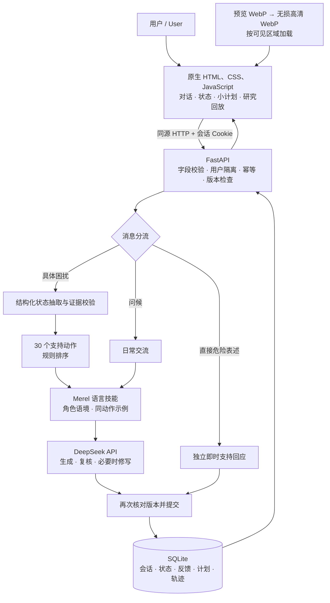
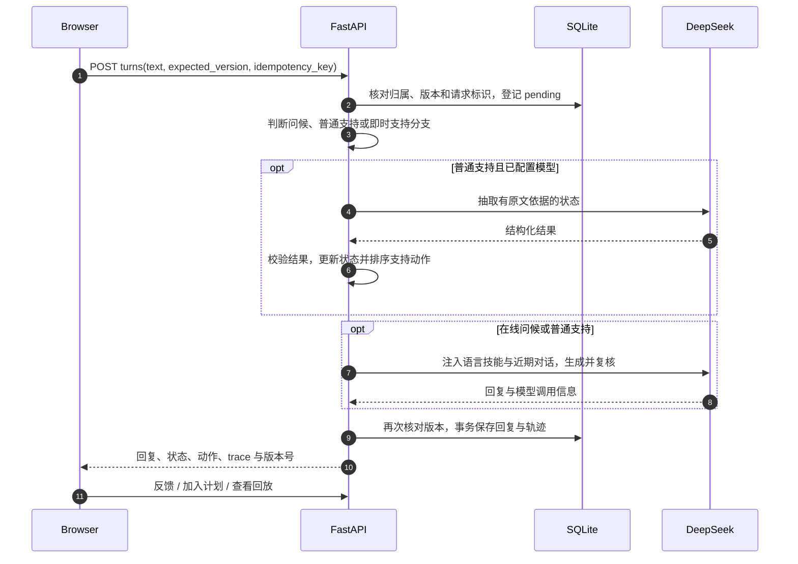

# 系统架构

前后端由一个 Python 服务同源提供。浏览器不持有模型密钥，图片和字体随项目部署；正常运行无需 Node.js、前端构建工具或本地 GPU。

### Request Lifecycle | 一轮对话如何完成

模型请求在数据库事务之外执行。相同请求标识和内容重复提交会重放原结果；生成期间状态发生变化时拒绝过期提交。在线调用失败会明确记录回退情况，回放中的 `generator` 与 `warnings` 表示该轮实际执行结果。
